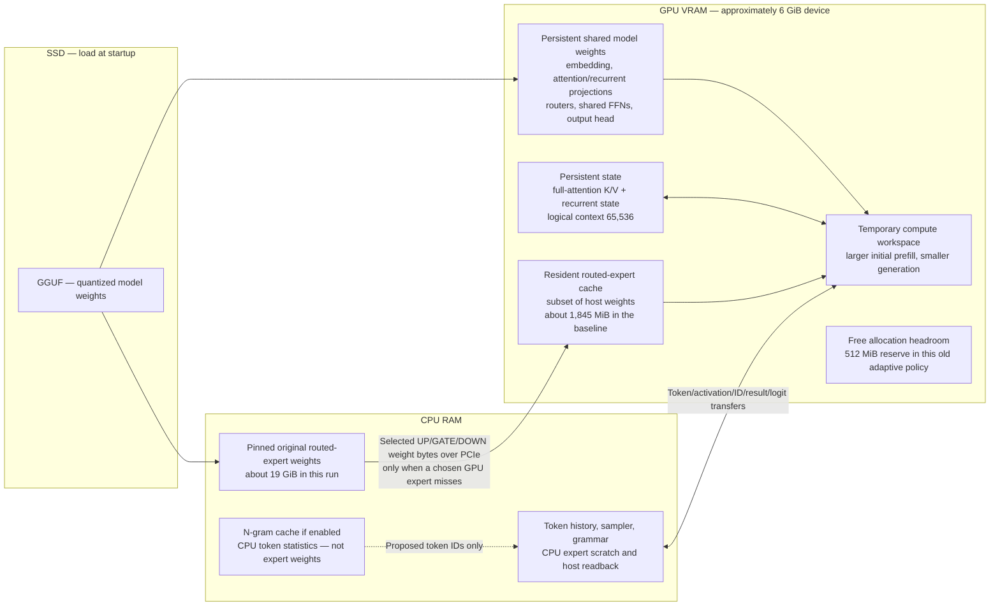
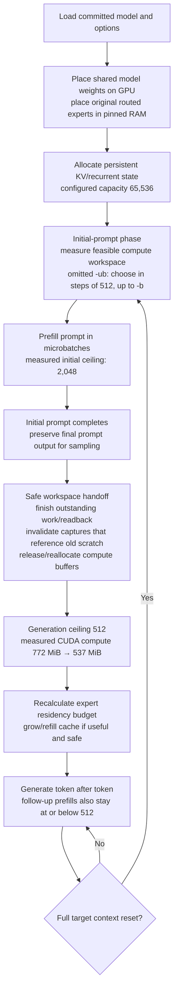
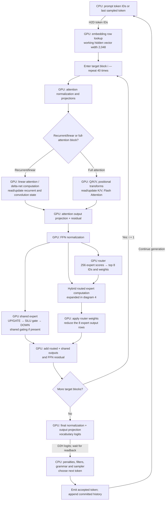
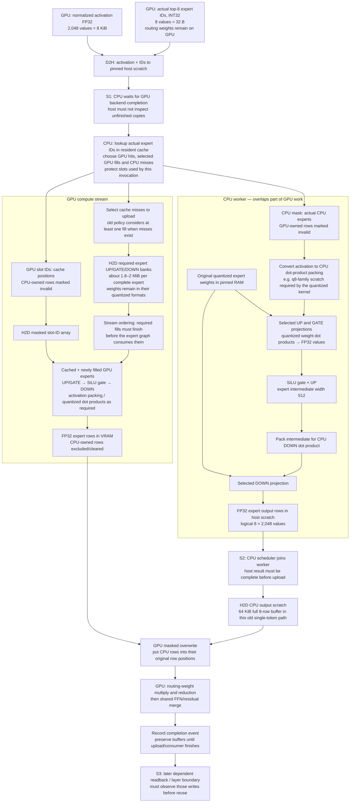
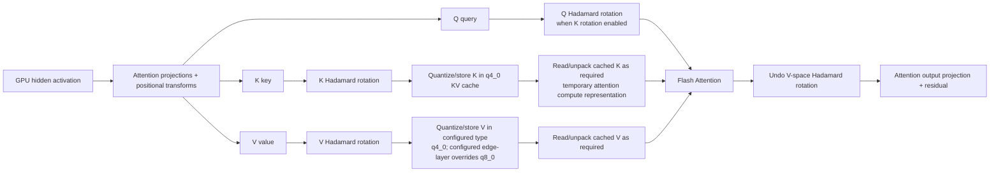
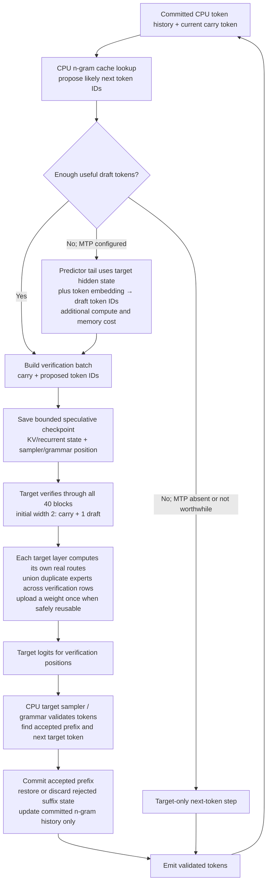
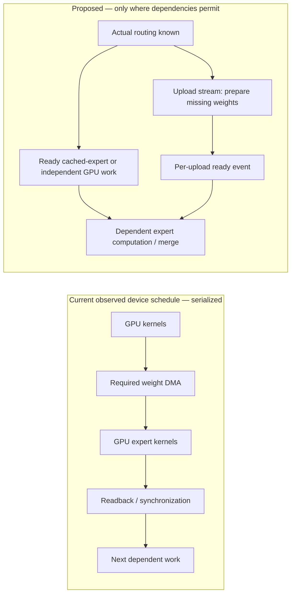

# Data flow: current Qwen MoE execution and proposed speculation

Source: committed `0e4e40b0`. Current means the measured launch with old residency, automatic residency/initial ubatch, generation ceiling 512, no MTP or other speculation. Proposed diagrams are labeled separately. Arrows express dependencies and data movement, not proportional elapsed time.

## 1. What A3B means and where memory lives

The inspected GGUF has 41 blocks, including one MTP predictor tail. The target graph loops over **40 transformer blocks**. It selects **8 of 256 routed experts per block and token**, plus the shared expert path. A3B describes approximately three billion active parameters per token across the model; it does not mean three billion parameters are permanently in VRAM or that there is a separate A3B layer group. Attention, router, shared expert, embedding and output weights are also used.

The expert cache stores the original quantized weights with device layout/padding. A cache fill does not convert the entire model to FP16. CPU-computed experts read their original weights in RAM and return results; their full weights need not cross PCIe. A cache hit reads existing VRAM weights without another RAM upload.

## 2. Startup, prefill and workspace handoff

Only the compute workspace changes size. Existing KV/recurrent state is not transformed from an ubatch-2048 format into an ubatch-512 format. Ubatch is how many token rows a compute graph may process at once, not the length or format of the stored conversation. Normal decoding here uses one token per target call despite the 512 workspace ceiling.

## 3. One complete target token

The shared and routed branches are a mathematical dependency diagram. Their independence does not mean the current scheduler overlaps their device kernels. The measured device kernel and copy timelines were serialized. The predictor tail is not part of this 40-block loop; it runs only when MTP is selected.

## 4. Inside one routed MoE layer — current old residency path

Optional paths: with no CPU-owned expert, skip CPU compute/result upload. With no GPU-owned expert, upload the CPU result directly. A valid GPU cache hit does not pass through the weight-upload node. Cache eviction changes which expert occupies a slot; it does not change the original RAM bank. Slot mapping alone is not proof that its bytes have finished uploading.

CPU and GPU do not independently add the same expert contribution twice. Their masks partition expert rows; the GPU first restores the full row order, then applies the original routing weights and reduction.

## 5. Attention cache conversions stay on the GPU

This is the full-attention branch, not every recurrent block. Quantized KV stays in its stored format; temporary unpacking does not convert the entire persistent context. The actual CUDA attention kernel chooses its working precision/layout. K/V cache Hadamard transforms do not transform routed expert weights. Recurrent state has its own representation; `-ctk/-ctv` do not imply all persistent state is q4.

## 6. Proposed speculative flow — token lookup first, optional MTP fallback

N-gram lookup does not predict real expert IDs, and an MTP tail's expert IDs are not target-layer expert IDs. The target still runs and validates proposals. Speed comes from useful accepted tokens per target verification, amortized weights/dispatch, and eventual transfer overlap—not from bypassing target validation.

The current stable residency path only handles width 1; its batched `new` path is separate. The general target verifier already exists. The simplified plan first measures that existing path; a new width-2 residency executor is conditional on a measured loss of benefit. It does not switch on the discarded experimental engine. An explicit `n_max=1` means one draft, not a width-8 verifier.

## 7. Current and desired transfer scheduling

This proposal requires separate readiness and leases. A required expert kernel cannot read a slot until its upload finishes. If all required experts are consumed by one indivisible kernel, merely moving the copy to another stream does not create overlap: launch a safe ready subset or use other truly independent work. Measure whether the extra partition/launch cost is worthwhile.

## Conversion and transfer ledger

| Item | Location and conversion | Crosses RAM/VRAM? |
| --- | --- | --- |
| Token IDs | CPU INT32 -> GPU IDs for embedding | H2D, small |
| Shared model weights | GGUF quantized/native storage -> persistent GPU buffers at load | Startup H2D, then reused |
| Original routed weights | Native quantized banks retained in pinned RAM | No transfer for CPU expert compute |
| GPU expert fill | Quantized bank slices -> padded VRAM cache slot | H2D on selected miss; dominant traffic |
| Router decisions | GPU top-8 IDs INT32 -> CPU cache planner | D2H 32 B per eligible single-token layer; wait before host read |
| FFN activation | GPU FP32 -> pinned CPU FP32 -> CPU dot-product packing | D2H 8 KiB; conversion is CPU scratch |
| CPU expert intermediate | FP32 UP/GATE -> gated activation -> dot-product packing -> FP32 DOWN | CPU-local |
| GPU expert intermediate | Kernel-specific activation packing, quantized matrix products, FP32 output rows | GPU-local |
| CPU expert outputs | Full FP32 row buffer -> GPU masked merge | H2D 64 KiB when CPU branch runs in old path |
| Full-attention K/V | Rotated working values -> stored q4_0/q8_0; unpacked as needed for attention | GPU-local in this configuration |
| Vocabulary logits | GPU FP32 output -> CPU sampling | D2H, roughly 1 MiB per token in measured trace |
| N-gram proposal | CPU cache -> proposed token IDs | Only the IDs later go to target GPU verification |
| MTP proposal | Predictor compute + target hidden-state handling -> proposed IDs | Placement-dependent; measure actual hidden/draft transfers |

Sources: `src/graphs/build_qwen35.cpp`, `src/llama-build-context.cpp`, `ggml/src/ggml-moe-resident-ffn.inc`, `ggml/src/ggml-backend.cpp`, `ggml/src/ggml.c`, `common/speculative.cpp`, the profiled server metadata, and the raw CUPTI capture. Timelines are schematic; measured unions and profiler overhead are recorded in the profile RESULTS.md.
